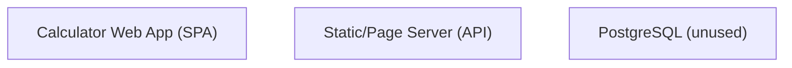
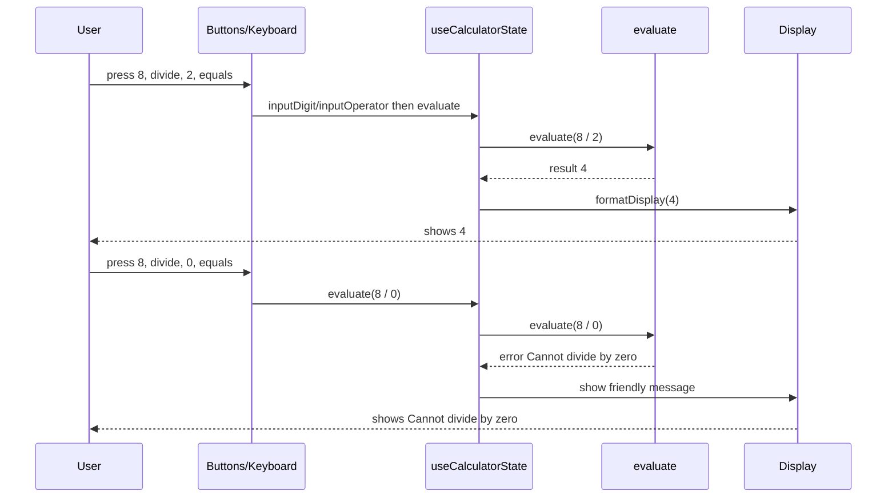
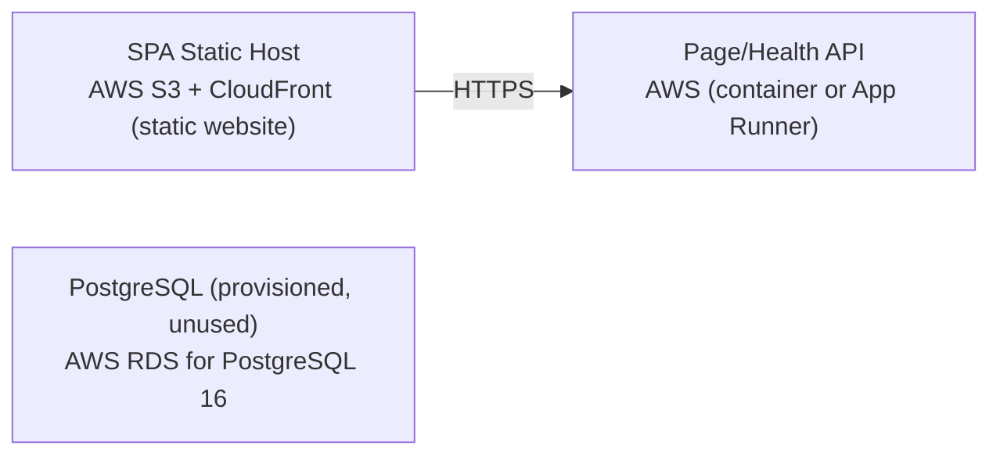

# Architecture

> Maintained by QuorQ AI SDLC. Text between `sdlc:auto` markers is regenerated; anything outside them is yours and is kept.

<!-- sdlc:auto:start narrative -->
## Overview

### ARCH-SUMMARY · approved · source: architecture:v2

calculator9 is a lightweight, single-page arithmetic calculator that runs entirely in the browser, with no accounts, payments, persistence, or history.

Approved architecture, version 2. A React 19 SPA renders the display and on-screen buttons, captures both click/tap and physical-keyboard input, evaluates add/subtract/multiply/divide/percent client-side, and shows friendly messages for division by zero and invalid input. FastAPI 0.115 exists only to serve the page and a health check. PostgreSQL 16 is named per the approved stack for completeness but is never read from or written to. Hosted on AWS, with the SPA and API served from two separate origins.

### ARCH-COMP-SPA · approved · source: architecture:v2

Calculator Web App (SPA), built with React 19, is the entire user-facing product.

Renders the responsive calculator UI, captures on-screen button presses and physical keyboard input, evaluates all arithmetic (add, subtract, multiply, divide, percent) client-side, updates the live display, handles clear/reset, and shows friendly errors for divide-by-zero and invalid input. Nothing is stored between sessions -- state lives only in the running page.

### ARCH-COMP-API · approved · source: architecture:v2

Static/Page Server (API), built with FastAPI 0.115, serves the calculator page and a health check.

Does no calculation and holds no business logic -- all arithmetic is client-side in the SPA. Exists named per the approved technology stack rather than for functional necessity.

### ARCH-COMP-DB · approved · source: architecture:v2

PostgreSQL 16 is listed in the approved stack for completeness but is unused by the product.

This product stores no data, so no tables are created and the application neither reads from nor writes to the database. Provisioned solely to match the approved stack.

### ARCH-PATH-001 · approved · source: architecture:v2

Critical path: evaluating a basic arithmetic calculation end to end in the SPA.

User enters an operand, an operator, a second operand and equals via on-screen buttons or keyboard. The SPA keeps the entry in component state, updates the display on each input, and computes the result client-side on equals. Division by zero and malformed entries produce a friendly message instead of a crash.

### ARCH-ENDPOINT-HEALTHZ · approved · source: architecture:v2

GET /healthz is the only API endpoint, used for liveness checks.

Liveness/health check for the page server so the AWS deployment can confirm the service is up. No calculation or business logic is exposed via the API.

### ARCH-DEPLOY-SPA · approved · source: architecture:v2

SPA Static Host deployment node serves the built React app as static assets.

Hosted on AWS S3 + CloudFront as a static website, serving the static assets produced by the React 19 build.

### ARCH-DEPLOY-API · approved · source: architecture:v2

Page/Health API deployment node runs the FastAPI service.

Hosted on AWS (container or App Runner), running FastAPI 0.115 on Python 3.12 via Uvicorn.

### ARCH-DEPLOY-DB · approved · source: architecture:v2

PostgreSQL deployment node is provisioned but unused.

Hosted on AWS RDS for PostgreSQL 16. Provisioned per the approved stack for completeness; the application does not connect to or use it.

### ARCH-TECH-FRONTEND · approved · source: architecture:v2

Frontend technology decision: React 19.

Chosen over Vue, Svelte, and Vanilla JS. The entire product is a single in-browser page; React 19 keeps the display in sync with every button press and keystroke via component state, and builds one responsive page that works on phone and desktop, matching the input/display/error capabilities in scope.

### ARCH-TECH-BACKEND · approved · source: architecture:v2

Backend technology decision: FastAPI 0.115.

Chosen over Flask, Node/Express, and static-only hosting. All calculation is client-side, so the backend does little more than serve the page and a health check. FastAPI 0.115 is the lightest, fastest option to stand up and never gets in the way for a product this simple.

### ARCH-TECH-DATABASE · approved · source: architecture:v2

Database technology decision: PostgreSQL 16, named but unused.

Chosen over SQLite and no database, per the approved stack for completeness. The product stores nothing between sessions and has no accounts, so no schema is defined and no queries are issued.

### ARCH-TECH-CLOUD · approved · source: architecture:v2

Cloud technology decision: AWS.

Chosen over Cloudflare Pages, Netlify, and Vercel. Hosting means putting one responsive page on the internet reliably and cheaply. AWS (S3 + CloudFront for the SPA, a small compute host for the API) does this at essentially no cost for this traffic profile and scales without attention if the page is shared widely.
<!-- sdlc:auto:end narrative -->

<!-- sdlc:auto:start building-blocks -->
## Building Block View

| ID | Name | Technology | Responsibility | Depends on |
|---|---|---|---|---|
| spa | Calculator Web App (SPA) | React 19 | Renders the responsive calculator UI, captures on-screen button presses and physical keyboard input, evaluates all arithmetic (add, subtract, multiply, divide, percent) client-side, updates the live display, handles clear/reset, and shows friendly errors for divide-by-zero and invalid input. Nothing is stored between sessions. | — |
| api | Static/Page Server (API) | FastAPI 0.115 | Serves the calculator page and exposes a health check. Does no calculation and holds no business logic -- all arithmetic is client-side. Named per the approved stack. | — |
| db | PostgreSQL (unused) | PostgreSQL 16 | Listed in the approved stack for completeness. This product stores no data, so no tables are created and the application neither reads nor writes to it. | — |

<!-- sdlc:auto:end building-blocks -->

<!-- sdlc:auto:start runtime -->
## Runtime View

### Evaluate a basic arithmetic calculation

User enters an operand, an operator, a second operand and equals via on-screen buttons or keyboard. The SPA keeps the entry in component state, updates the display on each input, and computes the result client-side on equals. Division by zero and malformed entries produce a friendly message instead of a crash.

- **Components:** spa
- **Modules:** CalculatorApp, useCalculatorState, evaluate, formatDisplay, keyboardHandler
- **Key functions:** inputDigit(digit), inputOperator(op), applyPercent(), evaluate(expr), clear(), handleKeyDown(event), formatDisplay(value)

<!-- sdlc:auto:end runtime -->

<!-- sdlc:auto:start deployment-view -->
## Deployment View

| Name | Service | Runtime | Scaling | Environment |
|---|---|---|---|---|
| SPA Static Host | AWS S3 + CloudFront (static website) | Static assets (React 19 build) | CDN edge caching; scales automatically with traffic | dev |
| Page/Health API | AWS (container or App Runner) | FastAPI 0.115 on Python 3.12 (Uvicorn) | Single small instance; scale-to-low for near-zero cost | dev |
| PostgreSQL (provisioned, unused) | AWS RDS for PostgreSQL 16 | PostgreSQL 16 | Smallest instance; no application traffic | dev |

| Source | Target | Protocol |
|---|---|---|
| SPA Static Host | Page/Health API | HTTPS |

<!-- sdlc:auto:end deployment-view -->

<!-- sdlc:auto:start decisions -->
## Architecture Decisions

| Layer | Choice | ADR |
|---|---|---|
| Frontend | React 19 | [ADR-0001](adr/frontend.md) |
| Backend | FastAPI 0.115 | [ADR-0002](adr/backend.md) |
| Database | PostgreSQL 16 | [ADR-0003](adr/database.md) |
| Cloud | AWS | [ADR-0004](adr/cloud.md) |
<!-- sdlc:auto:end decisions -->

<!-- sdlc:auto:start links -->
## Related Documents

- [Data Model](data-model.md)
- [API Specification](api/openapi.yaml)
- [Architecture Decision Records](adr/README.md)
<!-- sdlc:auto:end links -->
