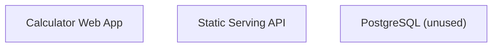
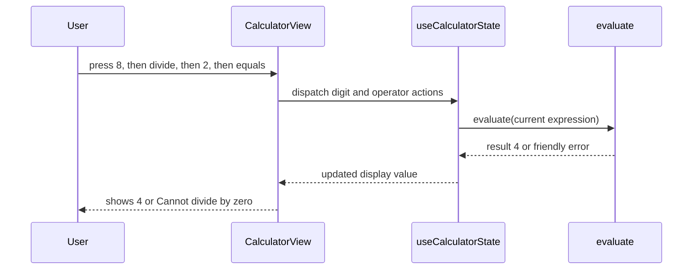
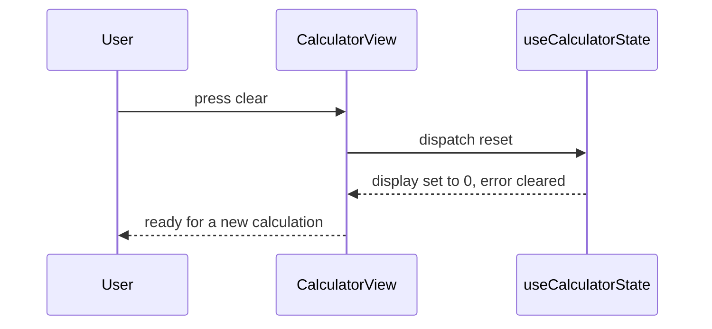
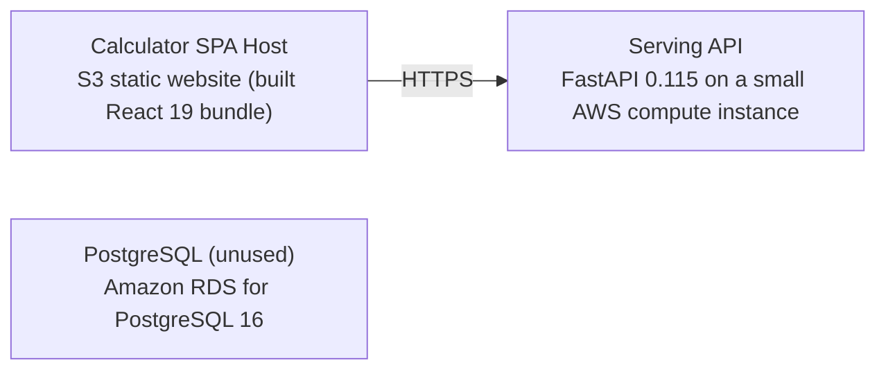

# Architecture

> Maintained by QuorQ AI SDLC. Text between `sdlc:auto` markers is regenerated; anything outside them is yours and is kept.

<!-- sdlc:auto:start narrative -->
## Overview

### ARCH-COMP-web_spa · approved · source: architecture:web_spa

Calculator Web App is the React 19 single-page app that renders the keypad/display and performs all arithmetic in-browser.

Component: Calculator Web App (React 19). Responsibilities: renders responsive digit/operator buttons and live display; captures both on-screen taps and physical keyboard input; executes addition, subtraction, multiplication, division and percent entirely client-side; shows friendly error messages for division by zero and invalid/incomplete entry instead of crashing. Nothing is persisted between sessions -- no local storage, no server round-trip for calculation.

**Related:** US-001, US-002, US-006, US-007, US-008, US-009

### ARCH-COMP-api · approved · source: architecture:api

Static Serving API is a thin FastAPI 0.115 service whose only job is serving the built page and a health check.

Component: Static Serving API (FastAPI 0.115). Does no calculation and holds no business logic -- all arithmetic lives in the browser. Its presence exists to satisfy the approved backend-stack choice rather than to do meaningful server-side work. Exposes the GET /healthz endpoint for liveness checks.

### ARCH-COMP-db · approved · source: architecture:db

PostgreSQL 16 is provisioned to satisfy the approved database layer but is never read from or written to.

Component: PostgreSQL (unused), PostgreSQL 16. The product stores no data at all -- no tables, no rows, no accounts -- so the database is provisioned for completeness only and never accessed by the application.

### ARCH-PATH-evaluate · approved · source: architecture:critical_path:Evaluate an arithmetic calculation

Primary critical path: user enters operands and an operator, presses equals, and the SPA evaluates and displays the result in-browser.

User enters operands and an operator via on-screen buttons or physical keyboard, presses equals, and the SPA evaluates the expression client-side and shows the result. Division by zero and incomplete/invalid entries yield a friendly message instead of a crash. Covers requirements US-001, US-002, US-006, US-008, US-009.

**Related:** US-001, US-002, US-006, US-008, US-009, ARCH-COMP-web_spa

### ARCH-PATH-clear · approved · source: architecture:critical_path:Clear and reset

Secondary critical path: user presses clear to discard the current entry or dismiss an error, resetting the display to 0.

User presses clear to discard the current value or in-progress calculation, or to dismiss an error message, returning the display to 0. Covers requirement US-007.

**Related:** US-007, ARCH-COMP-web_spa

### ARCH-ENDPOINT-healthz · approved · source: architecture:endpoint:GET /healthz

Single documented endpoint: a liveness probe exposed by the serving API.

GET /healthz -- liveness probe for the Static Serving API. Returns a simple status so the deployment pipeline can confirm the service is up. This is the only endpoint defined in the architecture; no calculation endpoints exist since arithmetic is client-side.

**Related:** ARCH-COMP-api

### ARCH-DEPLOY-spa · approved · source: architecture:deployment_node:Calculator SPA Host

The built React SPA is hosted as a static website on S3, served over HTTPS.

Deployment node: Calculator SPA Host -- S3 static website hosting the built React 19 bundle; static assets served over HTTPS.

**Related:** ARCH-COMP-web_spa

### ARCH-DEPLOY-api · approved · source: architecture:deployment_node:Serving API

The FastAPI serving layer runs on a small AWS compute instance.

Deployment node: Serving API -- FastAPI 0.115 running on a small AWS compute instance, using Python 3.12 and Uvicorn.

**Related:** ARCH-COMP-api, ARCH-ENDPOINT-healthz

### ARCH-DEPLOY-db · approved · source: architecture:deployment_node:PostgreSQL (unused)

An unused PostgreSQL 16 instance is provisioned via Amazon RDS for stack completeness.

Deployment node: PostgreSQL (unused) -- Amazon RDS for PostgreSQL 16. Provisioned but never read from or written to, since the application persists no data.

**Related:** ARCH-COMP-db

### ARCH-TECH-frontend · approved · source: architecture:technology_decision:Frontend

Frontend technology choice: React 19, built as a Vite SPA, over alternatives Vanilla JS, Vue, and Svelte.

Decision: React 19 drives the whole product -- it keeps the on-screen number in sync with every button press and keystroke via component state, and produces one responsive page that works the same on phone and desktop. Built as a Vite SPA reading the VITE_API_BASE_URL environment variable. Alternatives considered: Vanilla JS, Vue, Svelte.

**Related:** ARCH-COMP-web_spa

### ARCH-TECH-backend · approved · source: architecture:technology_decision:Backend

Backend technology choice: FastAPI 0.115, named per the approved stack, over alternatives Flask and Node/Express.

Decision: FastAPI 0.115 was named in the approved stack. In this design it does little more than serve the calculator page and a health check, since all calculation is client-side and there is no real server-side work. Alternatives considered: Flask, Node/Express.

**Related:** ARCH-COMP-api

### ARCH-TECH-database · approved · source: architecture:technology_decision:Database

Database technology choice: PostgreSQL 16, named for completeness with the approved stack; the only listed alternative was no persistence at all.

Decision: PostgreSQL 16 was named in the approved stack for completeness. The calculator stores nothing between sessions and has no accounts, so no schema exists and the database is never read or written. Alternative considered: None (no persistence needed).

**Related:** ARCH-COMP-db

### ARCH-TECH-cloud · approved · source: architecture:technology_decision:Cloud

Cloud technology choice: AWS, over alternatives Cloudflare Pages, Netlify, and Azure.

Decision: Hosting means putting one responsive page on the internet reliably and cheaply. AWS (S3 for the static SPA, a small instance for the API) does this at essentially no cost for this traffic profile and scales without attention if the page is shared widely. Alternatives considered: Cloudflare Pages, Netlify, Azure.

**Related:** ARCH-DEPLOY-spa, ARCH-DEPLOY-api, ARCH-DEPLOY-db
<!-- sdlc:auto:end narrative -->

<!-- sdlc:auto:start building-blocks -->
## Building Block View

| ID | Name | Technology | Responsibility | Depends on |
|---|---|---|---|---|
| web_spa | Calculator Web App | React 19 | Responsive single-page calculator UI: renders digit/operator buttons and display, captures on-screen taps and physical keyboard input, runs all arithmetic (add, subtract, multiply, divide, percent) client-side, and shows friendly error messages for division by zero and invalid input. Nothing is persisted between sessions. | — |
| api | Static Serving API | FastAPI 0.115 | Serves the built calculator page and exposes a health endpoint. Does no calculation and holds no business logic — all arithmetic is client-side. Named per the approved stack to satisfy the backend choice. | — |
| db | PostgreSQL (unused) | PostgreSQL 16 | Provisioned to satisfy the approved database layer. This product stores no data at all — no tables, no rows — so the database is never read from or written to. | — |

<!-- sdlc:auto:end building-blocks -->

<!-- sdlc:auto:start runtime -->
## Runtime View

### Evaluate an arithmetic calculation

User enters operands and an operator via buttons or keyboard, presses equals, and the SPA evaluates the expression in-browser and shows the result. Division by zero and incomplete/invalid entries yield a friendly message instead of a crash. Covers US-001, US-002, US-006, US-008, US-009.

- **Components:** web_spa
- **Modules:** CalculatorView, useCalculatorState, evaluate, inputReducer, keyboardHandler
- **Key functions:** applyDigit(state, digit), applyOperator(state, op), applyPercent(state), evaluate(state), formatDisplay(value), handleKey(event)

### Clear and reset

User presses clear to discard the current value or in-progress calculation, or to dismiss an error message, returning the display to 0. Covers US-007.

- **Components:** web_spa
- **Modules:** CalculatorView, useCalculatorState, inputReducer
- **Key functions:** reset(state)

<!-- sdlc:auto:end runtime -->

<!-- sdlc:auto:start deployment-view -->
## Deployment View

| Name | Service | Runtime | Scaling | Environment |
|---|---|---|---|---|
| Calculator SPA Host | S3 static website (built React 19 bundle) | Static assets over HTTPS | Serverless/static — scales automatically with request volume at near-zero cost | dev |
| Serving API | FastAPI 0.115 on a small AWS compute instance | Python 3.12 / Uvicorn | Single small instance; sufficient as it serves only a health check | dev |
| PostgreSQL (unused) | Amazon RDS for PostgreSQL 16 | PostgreSQL 16 | Smallest instance; provisioned for stack completeness, carries no data | dev |

| Source | Target | Protocol |
|---|---|---|
| Calculator SPA Host | Serving API | HTTPS |

<!-- sdlc:auto:end deployment-view -->

<!-- sdlc:auto:start decisions -->
## Architecture Decisions

| Layer | Choice | ADR |
|---|---|---|
| Frontend | React 19 | [ADR-0001](adr/frontend.md) |
| Backend | FastAPI 0.115 | [ADR-0002](adr/backend.md) |
| Database | PostgreSQL 16 | [ADR-0003](adr/database.md) |
| Cloud | AWS | [ADR-0004](adr/cloud.md) |
<!-- sdlc:auto:end decisions -->

<!-- sdlc:auto:start links -->
## Related Documents

- [Data Model](data-model.md)
- [API Specification](api/openapi.yaml)
- [Architecture Decision Records](adr/README.md)
<!-- sdlc:auto:end links -->
