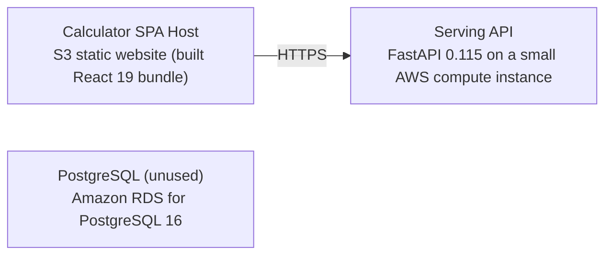

# Deployment Guide

> Maintained by QuorQ AI SDLC. Text between `sdlc:auto` markers is regenerated; anything outside them is yours and is kept.

<!-- sdlc:auto:start how-it-deploys -->
Pushes to `main` run `.github/workflows/deploy.yml`, which builds the API image (if there is a backend) and deploys the SPA to AWS Amplify. Commits touching only `docs/sdlc/**` don't deploy. Deployments can also be started from the platform's Deployment tab.
<!-- sdlc:auto:end how-it-deploys -->

<!-- sdlc:auto:start environments -->
| Name | Service | Runtime | Scaling | Environment |
|---|---|---|---|---|
| Calculator SPA Host | S3 static website (built React 19 bundle) | Static assets over HTTPS | Serverless/static — scales automatically with request volume at near-zero cost | dev |
| Serving API | FastAPI 0.115 on a small AWS compute instance | Python 3.12 / Uvicorn | Single small instance; sufficient as it serves only a health check | dev |
| PostgreSQL (unused) | Amazon RDS for PostgreSQL 16 | PostgreSQL 16 | Smallest instance; provisioned for stack completeness, carries no data | dev |
<!-- sdlc:auto:end environments -->

<!-- sdlc:auto:start live -->
_Not deployed yet._
<!-- sdlc:auto:end live -->

<!-- sdlc:auto:start topology -->

<!-- sdlc:auto:end topology -->
